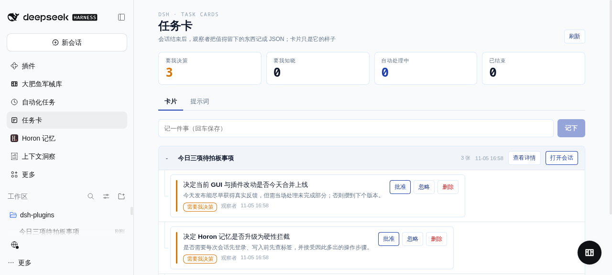
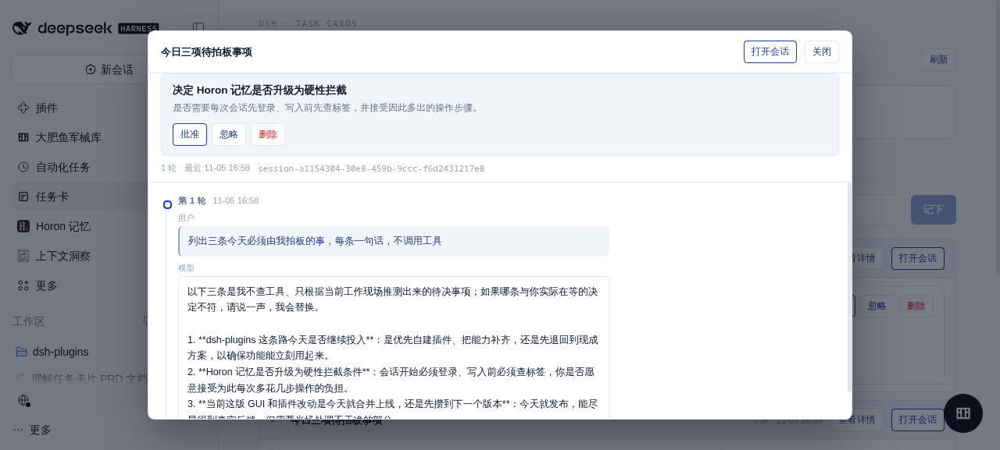

# dsh-task-cards

会话结束后，观察者把值得留下的东西记成 JSON；卡片只是它的展现。人只看两组：**要我决策**、**要我知晓**；能自动处理的（限流重试这类）交给扫描器。





## 现在能做什么

- **回合结束自动记卡**：任何顶层会话一轮结束（`agent/status` → idle），插件另起一个**没有工具**的观察者会话，把最后那段回复整理成 JSON 卡。
- **观察者不碰原会话**：只读事件流，不往原会话里投任何东西。
- **三种卡**：`decision` 要我拍板、`info` 要我知晓、`auto` 可自动处理（带 `action`）。分类由系统提示词决定。
- **决策代理人出票拟**：卡建好后另跑一个无工具会话，只给它卡和你过去的同类决定（判例）。它把错标成「要我决策」的事实卡降级为「要我知晓」，其余每张给 2–3 个方案（成本 / 长期收益 / 最坏情况）并标出推荐哪个。
- **票拟可被自动执行**：当它判定某个推荐「撤回不需要你动手」时标 `autoApply`，系统直接把那句话发回原会话、把卡结束——你只看到结果。不可逆的事（改代码、删数据、对外发声、花钱）仍要你批红。自动执行不写判例（判例只记你本人的决定）。
- **批红就是推进**：决策卡点「批准」= 把票拟推荐的话投回原会话，那边的活继续往下走；没有可回访会话时会明确告诉你，而不是静默打个勾。
- **决策者有独立页签**：面板 `卡片 / 观察者 / 决策` 三页；决策页有它自己的提示词、开关、模型、判例库，以及**每次运行记录**（出票拟几张、自动执行几张、降车道几张、耗时、失败原因）。
- 详见 [docs/decision-agent.md](docs/decision-agent.md)。
- **观察者的输入**：最近三轮「用户输入 + 模型最终输出」，不是只看最后一句回复。
- **自动执行**：`src/host/scanner/` 每 30 秒扫到点的 `auto` 卡，在原会话里替用户补一句话（429 → 10 分钟后重试，400 → 立即重试）。成功收卡，失败退回「要我知晓」并记原因。
- **提示词可视化编辑**：保存后下一轮生效（不用重启）。
- **只认 JSON**：先原样解析，再抠代码块，再扫平衡括号块；都不行重试一次，仍失败记异常、放弃这张卡。
- **提问两边都能答**：聊天里的提问卡片和我们的任务卡同时出现，谁先答谁生效。卡片先答 → 作为 `ask_user_question` 的原生结果回给模型；聊天先答 → 自动回写到卡片上。只有会话已中断才退回模拟用户输入。
- **卡片按会话成树**：外层是会话（可展开/收起），内层是该会话的卡，新的在上；外层有「打开会话」（跳到 dsh 里的原始会话）和「查看详情」。
- **弹窗里直接审批**：从「等待决策」的卡片点开详情，弹窗顶部是这张卡（标题、详情、选项、批准 / 忽略 / 删除），下面是它所属会话的时间线；处理完原地更新，不用关弹窗回列表。
- **详情弹窗是时间线**：左侧竖轴 + 轮次圆点，每轮标「第 N 轮 · 时间」，每段标「用户 / 模型」；模型输出超过 6 行折叠，默认只显示最近 3 轮，往上有「显示更早的 N 轮」；Esc 关闭，键盘可操作。
- **两种回复路径**：`question` 卡（模型提问把对话卡住）优先走宿主提问通道 `userQuestions.answer`，会话没了就退回模拟用户输入；`reply` 卡一律模拟用户输入。
- **观察者会话在侧栏可见**：挂在工作区「任务卡观察者」下，直接看 dsh 自己的对话与轨迹；插件里没有「记录」页签，因为那份信息在会话里更全。
- **观察者会话是子代理身份**（会话日志里有 `subagent/descriptor`），所以宿主的 Agent Team 不会给它装工具；同时它仍挂在「任务卡观察者」工作区里，侧栏能看到、能点开看对话。
- **工具 / 技能白名单**：`policy.json` 一份文件管所有角色（`observer` / `worker` / `default`），改文件或走 `/api/policy` 即时生效；观察者默认零工具零技能。

## 它是怎么接进宿主（这是最兼容 DSH 的方式）

| 环节 | 用的是什么 |
| --- | --- |
| 触发 | `agent/status` 变 `idle` + `session/event` 累积本轮回复与 usage |
| 观察者会话 | `ctx.agents.create()` 建真会话，再 `ctx.agentPresets.select()` 挂到自定义 preset |
| 没有工具 | 自定义 preset `task-cards-observer` 里只挂一个提示词插件，没有任何 tool/skill 行 |
| 系统提示词 | 该插件注册一个 `complete` 的 `systemPrompt.section`，每次装配从 `settings.json` 读 |
| 模型 | 面板里选；不选就跟随宿主的默认模型选择（`agentDefaultModel.currentSelection()`） |
| 记账 | 观察者会话就是普通 DSH 会话：usage、token、事件流全部由宿主记录 |

观察者会话跑在插件自己的工作区「任务卡观察者」(`$DSH_HOME/dsh-task-cards/workspace`)，**在侧栏可见**：点进去就是 dsh 原生的对话与轨迹视图，不用插件另做一套。

## 目录

| 路径 | 跑在哪 | 干什么 |
| --- | --- | --- |
| `src/shared/` | 两端共用 | zod 契约、路由常量、状态机、ABI 常量 |
| `src/host/index.ts` · `wire.ts` | 宿主 | 入口与装配 |
| `src/host/observer/` | 宿主 | 观察者流水线 + 只注册提示词的 preset 插件 |
| `src/host/decision/` | 宿主 | 决策代理人：票拟输入/解析/执行/落卡 + 判例 |
| `src/host/routes/` | 宿主 | 9 个后端端点，一个端点一个文件 |
| `src/host/cards/` `scanner/` `policy/` `question/` | 宿主 | 存储、定时执行、白名单、提问回填 |
| `src/client/` | 浏览器 | 面板：components / hooks / locale / api / styles |
| `lib/` | 构建产物 | `pnpm build` 生成；`lib/index.js`、`lib/observer-prompt.js`、`lib/client.js` |
| `tests/` | Node | 70 个用例：契约、边界、存储、路由、观察者输入、卡片排序、面板渲染、bundle ABI |

数据在 `$DSH_HOME/dsh-task-cards/`：`cards.json`、`settings.json`、`policy.json`、`records.json`、`precedents.json`（你的判例）、`workspace/`。

## 挂进 profile

```bash
git clone https://github.com/guicaiyue/dsh-task-cards.git
cd /path/to/your/dsh-home/profiles/web
dsh plugin --profile web add link:/path/to/dsh-task-cards
# 再在 cordis.patch.yml 末尾加：
# - insert:
#     - id: dsh-task-cards
#       name: dsh-task-cards
```

`link:` 安装会跑 `prepare`（= `pnpm build`）；手工改完代码记得 `pnpm build`，宿主会在 500 ms 内热重载客户端模块。
回滚：删掉那条 insert，`dsh plugin --profile web remove dsh-task-cards`。

## 验收（五分钟）

1. 随便开一个会话，问一个会长篇回答的问题，等它答完。
2. 打开侧栏「任务卡」：「卡片」里出现观察者写的卡，按「要我决策 / 要我知晓 / 自动处理中」分组；没有值得留的事时状态是「无卡」，这也是对的。
3. 侧栏「任务卡观察者」工作区里能看到刚才那次观察者会话，点开就是原生对话（含模型、token、工具次数）。观察者会话按子代理身份跑，宿主不会给它装工具。
4. 「提示词」里改一句、保存 → 下一轮按新提示词输出（分类规则也在这里改）。

完整的浏览器验收清单在 [docs/verification.md](docs/verification.md)。

## 开发

```bash
pnpm install      # 首次（会先 build 一次）
pnpm dev          # 改 src 自动重建，浏览器热重载
pnpm verify       # lint → typecheck → test → build → ABI → 代码预算
```

规范（AI 与人同一套，提交时由 lefthook 强制）：

- 字段先改 `src/shared/contract.ts` 的 zod schema，类型与文档都从它派生。
- 客户端不碰 Node，宿主不碰 React（Biome 与测试双重拦截）。
- 单文件 ≤300 行、接线文件 ≤150 行、函数 ≤60 行；客户端产物 ≤150 KB。
- 提交信息 `type(scope): 中文摘要`，type/scope 枚举见 `commitlint.config.mjs`。

更多：[架构](docs/architecture.md) · [契约](docs/contracts.md) · [宿主 ABI](docs/host-abi.md) · [命令](docs/commands.md) · [验收](docs/verification.md) · [ADR](docs/adr/)
