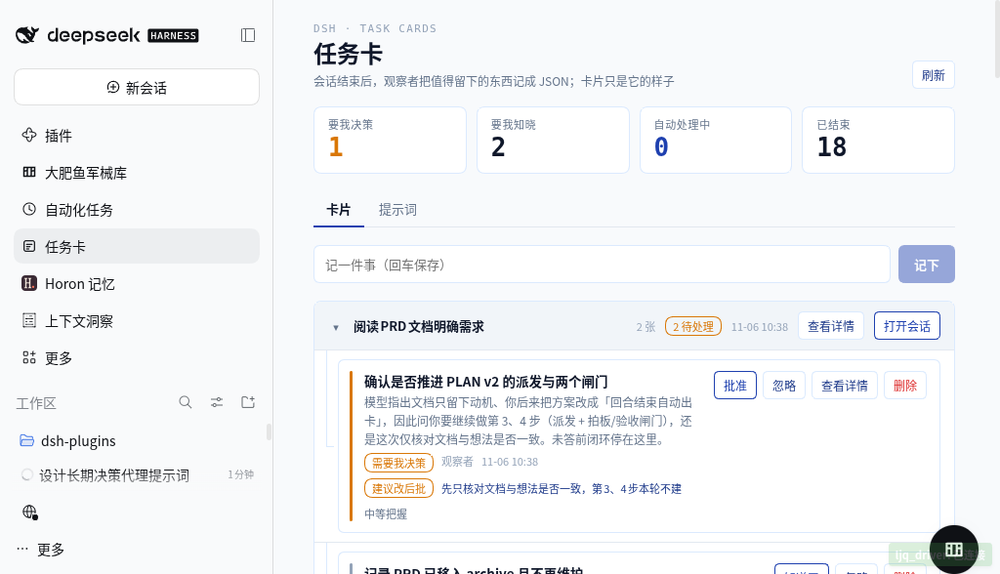
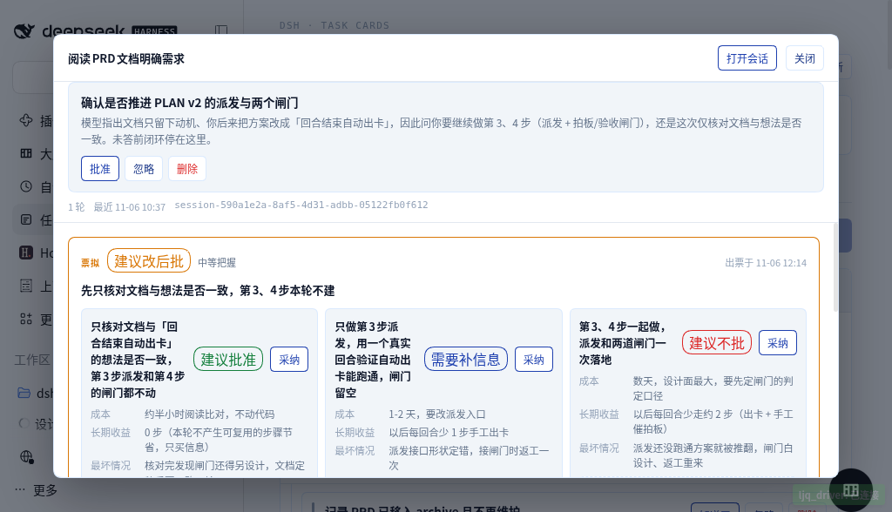
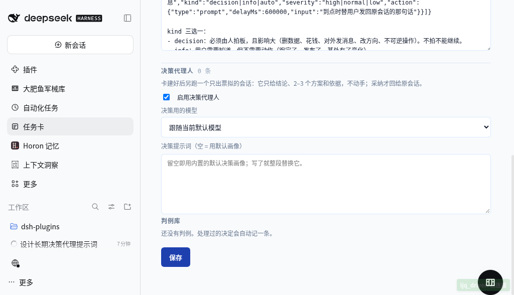

# 决策代理人

观察者负责「把值得留下的事记成卡」。决策代理人负责下一段：**牌桌上的牌收干净，只留必须由人拍板的那几张。**

它做两件事，不做第三件：

1. **把不该占注意力的卡移开**——被错标成 `decision` 的纯事实卡，降级为 `info`。这是唯一允许它自己动手的写操作：可逆、不改变外部世界、不需要人回滚。
2. **给必须拍板的卡出一张票拟**——结论 + 2–3 个方案，每个方案写成本、长期收益（以后每次少走几步）、最坏情况，外加一句「采纳后回给原会话的话」。人看一眼点一下，就是批红。
3. ~~不替人做不可逆的决定~~。它只会执行**自己判定为可逆且便宜**的那一类：在票拟里给 `autoApply: true`，系统就把该方案的 `answer` 发回原会话、把卡标完成。其余一律落盘等人批红。

> **它不会替自己发合格证**：自动执行不写判例。判例只由人的动作产生，否则它会拿自己的判断教自己，越跑越像它自己而不是你。

## 这条流水线

```
观察者建卡（kind = decision / info / auto）
        │  本次新建的卡
        ▼
决策会话（无工具 preset，独立 session，只读卡与判例）
        │  只输出 JSON：{"decisions":[{cardId, lane, ask, verdict, summary, effect, requires[], action, scope, reversible, candidates[], options[], basis, precedentIds, confidence, question}]}
        ▼
parse → 写回 card.advice（事件 advised）
        │  车道只是 decision → info 时顺手纠正（事件 lane:info）
        ▼
面板：卡片行显示结论 chip；详情弹窗展开方案对照 → 采纳 / 返工标记
        │  采纳 = 把该方案的 answer 回给原会话（复用现有作答通道）
        │  或：票拟标了 autoApply 且设置允许 → 系统直接执行，卡变 done
        ▼
判例库 precedents.json（决策卡的作答 / 完成 / 忽略 / 批红 / 采纳都落一条）
```

失败重试一次，仍失败只记日志与卡事件，不影响卡本身可用。

## 三种请求：判断 / 许可 / 澄清

`kind=decision` 还不够具体；决策代理人再标一层 `ask`：

- `judgment`：有 A/B 两个以上方向要比较。给 2–3 个方案，每个写成本 / 长期收益 / 最坏情况。
- `permission`：只有一个已定动作，等用户 yes/no（提交、改代码、推送、删除、花钱、对外发消息）。不给替代设计，只给 `action` / `scope` / `effect` / `reversible`；面板显示「允许一次 / 拒绝」，两句话都由宿主模板生成。
- `clarification`：只缺一条事实/指代（是哪张卡、哪个文件、哪个账号）。不给方案，只给 `question` + `candidates`；面板给候选按钮和输入框，答复会拼成「补充信息：…。这是对「…」的回答，继续。」。如果卡片 `origin.uiCardId` 非空（建卡时面板正打开着另一张卡），宿主会直接用这张卡的 id 作为答案并自动投递，不再问用户；模型也可以主动把 `answer`、`effect=read`、`autoApply=true` 写出来。

拿不准时：judgment/permission 拿不准选 permission（少让人做设计）；permission/clarification 拿不准选 clarification（只补信息）。

## 自动执行闸门

`autoApply=true` 只是候选，真正投递前还要过 `decision/answer-guard.ts`：

1. `effect` 必须是 `read`；`write-code` / `destructive` / `external` / `spend` 一律拦。
2. `requires` 必须全在当前能力清单里（`session.reply` / `cards.complete` / `cards.acknowledge` / `cards.dismiss`）；插件没有写卡片正文的接口，所以 `cards.append` / `cards.write-body` 会被拦。
3. `answer` 必须能独立成立：不得出现「这张卡 / 上一张 / 刚才那张」这类没有具体目标的指代；需要指代时写卡片 id 或标题。
4. 必须有 `origin.sessionId`，否则没有可投递的会话。

任何一条不满足：不投递，把原因写进 `advice.blockedReasons`，面板详情直接显示；人工批准只拦「不存在的能力」，不拦指代。自动执行成功/失败都不写判例。

## 提示词就是他的决策画像

默认提示词在 `src/host/decision/defaults.ts`（`DEFAULT_DECISION_PROMPT`），面板「设置 → 决策代理人」可改；`decisionPrompt` 留空即用默认。八条判据全部来自他本人的回答，不是通用最佳实践：

| # | 判据 | 来源问题 | 写进提示词后约束了什么 |
| :-- | :-- | :-- | :-- |
| 1 | 只从中长期看：投入要预计三个月到半年后还在起作用，才值得为结构多付成本 | 「你说的中长期是多长？」→ 三个月到半年 | 低于这个尺度的「更优雅」不许当理由 |
| 2 | 方案第一项必须是**最小可验证的一步** | 「哪件事当时图快后来返工？」→ 先大设计再跑通、方案推翻重来 | 禁止一上来给完整方案 |
| 3 | 判「做」之前先问：这个动作三个月后还能不能找到痕迹 | 「你常后悔的形状」 | 拦住「白做」型动作 |
| 4 | 长期收益只按「以后每次少走几步」计量 | 「票拟里长期收益用什么计价？」→ 以后每次少走的步骤数 | 禁止「更清晰 / 更规范」充当收益；写不出就写 0 步 |
| 5 | 正例是复利型做法：沉淀成可复用的工具/脚本/SOP | 「哪类事一年后还在产生回报？」→ 沉淀成可复用的工具/脚本/SOP | 方案里默认给一条复用路线 |
| 6 | 试错期不沉淀：方案可能被推翻时只买信息 | 「什么情况下你说别沉淀了？」→ 还在试错期 | 判断不了是否试错期，就按试错期算 |
| 7 | 可逆且便宜 = 撤回不需要他本人动手 | 「能撤回但要你花十几分钟算便宜吗？」→ 不用你动手就算便宜 | 只有这种才允许自动判掉 |
| 8 | 判例优先于直觉；**返工过的判例自动失效** | 「上次同类决定本身是图快的，还照做吗？」→ 不照做 | `outcome=reworked` 的判例不进决策输入 |

再加两条结构性约束：**要权衡不要推荐**（只给一个结论会显得没做功课），**不编造判例编号**（没有同类就写「无同类判例」且 confidence 不许 high）。

## 判例（precedents.json）

一张**决策卡**被处理（作答 / 完成 / 忽略 / 批红）时落一条判例：当时要定的事、当时的问法、他当时怎么定的、后果。通知卡（`info`）的「已读」和自动卡的取消不算决定，不进判例库。

- `choice`：回答文本，或「批了」/「不批，忽略」。
- `outcome`：`unknown` → 还没验收；`valid` → 事后确认没返工；`reworked` → **他后来返工了**。
- 返工标记是一次性的、显式的：面板上「这个决定后来返工了」+ 一句原因。**不猜、不自动推断**。
- 决策输入里只送 `unknown` 与 `valid` 的判例，`reworked` 的一条都不送——否则等于建议他重犯。

数据在 `$DSH_HOME/dsh-task-cards/precedents.json`，上限 500 条，倒序；一次输入最多带 `decisionPrecedentLimit` 条（默认 30）。

## 配置

| 设置项 | 默认 | 说明 |
| :-- | :-- | :-- |
| `decisionEnabled` | `true` | 关掉就只建卡、不出票拟 |
| `decisionPrompt` | 空 | 空 = 用 `DEFAULT_DECISION_PROMPT` |
| `decisionProvider` / `decisionModel` | 空 | 空 = 与观察者一致的默认模型 |
| `decisionPrecedentLimit` | `30` | 单次输入带多少条判例 |
| `decisionAutoApply` | `true` | 允许系统直接执行 `autoApply=true` 的票拟；关掉就退化成「全部等人批红」 |

一次决策会话覆盖「本次观察者新建的一批卡」，不是一张卡开一个会话：省 token，也方便它横向比较。

## 自动执行：谁来按那个按钮

票据分三种命运：

| 票拟 | 谁动手 | 卡的去向 |
| :-- | :-- | :-- |
| `autoApply: true` 且 `decisionAutoApply` 开着且过闸门 | **系统**（把 `answer` 发回原会话） | `done`，事件 `advice-applied` |
| `autoApply: true` 但闸门拦下 | 不投递，等人批 | `open`，`advice.blockedReasons` 写明原因 |
| 其余票拟 | 你（「批准」或「采纳某个方案」） | `done`，事件 `approved` / `answered` |
| 自动执行**投递失败** | 你（卡留在待决策，并带上失败原因） | `open` + `lastError`，事件 `advice-applied:failed` |
| 你标返工 | 你 | 状态不变，判例 `outcome=reworked` |

「批准」不是把卡打个勾就完事——**它等于往原会话投一句话**（票拟推荐方案的 `answer`，没有票拟就用卡片详情兜底成一句「已批准：<标题>。按这个方向继续。」）。这样批完红，那边的会话就会继续干，而不是等你再去找它。

没有可回访会话的卡（人手动建的、会话已删）会照样标完成，但面板会明确告诉你「没有可回访的会话」——不静默。

## 执行记录：它到底跑没跑

决策阶段每次运行都会写一条 `phase: 'decision'` 的记录（和观察者记录同一份 `records.json`）：状态、模型、耗时、出票拟张数、自动执行张数、降车道张数、失败原因。面板「决策」页签直接列出最近 30 条，空态写「还没有跑过」。

这条是为了回答一个具体问题：**上一轮票拟是不是没跑，还是跑了但被判成不该动？** 没有记录时，两种情况的表面现象完全相同（卡上没票拟）。

## 边界（别再往里加）

- 不自动执行「不可逆」的 `action`：外部世界留痕的事（改代码、删数据、对外发声、花钱）必须人批。`autoApply=true` 只覆盖撤回不需要你动手的那一类。
- 自动执行不写判例（见上）。
- 不做跨卡合并或拆分：一张卡一条 decisions。
- `POST /decisions {action:'preview'}` 是只读预演：跑同一套提示词/输入，返回解析后的票拟，但不写卡、不投递、不记执行记录。
- 不写判例的 `valid` 判断：验收只能由人（或明确的成功信号）给，代理人越权就是自己给自己发合格证。
- 不改观察者的分类提示词：分类与决策是两段，混在一起会让两边都变差。

## 真机验收（2026-11-06，v0.2.0）

宿主重启后对一张真实决策卡跑 `redecide`，21 秒出票拟。下面这段是原始输出，可以对照八条判据看它有没有真的照做：

```
verdict: modify ｜ confidence: normal ｜ lane: decision ｜ applied: false
summary: 先只核对文档与想法是否一致，第 3、4 步本轮不建
basis:   无同类判例；方案还没跑通，闸门口径未验证，按试错期只买信息处理
options:
  1. 只核对文档与「回合结束自动出卡」的想法是否一致，第3步派发和第4步的闸门都不动
     成本 约半小时阅读比对，不动代码
     长期收益 0 步（本轮不产生可复用的步骤节省，只买信息）
     最坏 核对完发现闸门还得另设计，文档定稿后要再改一轮
  2. 只做第3步派发，用一个真实回合验证自动出卡能跑通，闸门留空
     成本 1-2 天，要改派发入口 ｜ 长期收益 以后每回合少 1 步手工出卡
  3. 第3、4步一起做，派发和两道闸门一次落地
     成本 数天，设计面最大 ｜ 长期收益 以后每回合少走约 2 步 ｜ 最坏 派发还没跑通方案就被推翻，闸门白设计
```

它做对的四件事：① 第一项是最小验证一步；② 试错期判定生效，长期收益如实写「0 步」而不是编一个「更清晰」；③ 没有判例就说没有，把握不标 high；④ 三个方案的长期收益全部按「少走几步」计价。






